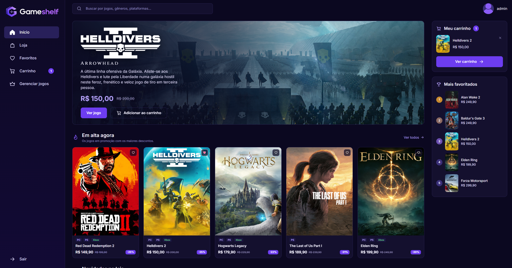
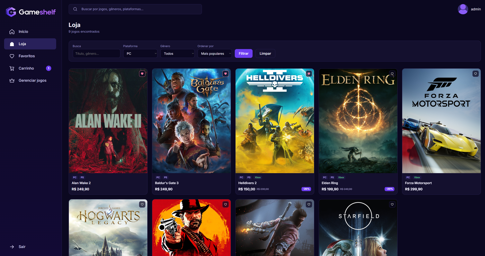
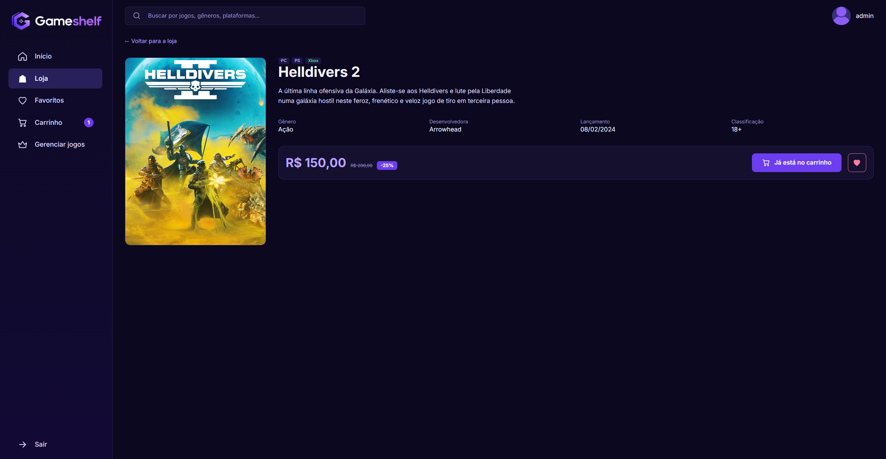
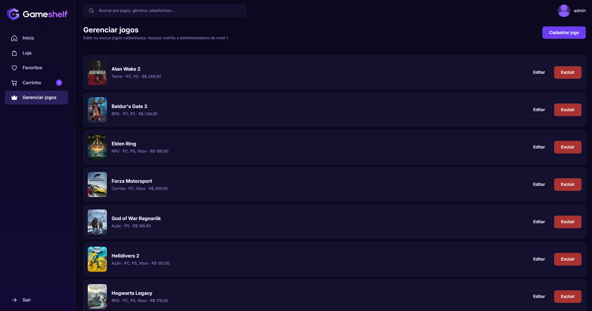
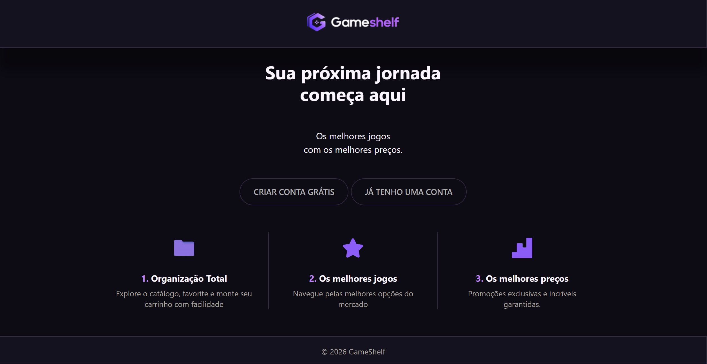
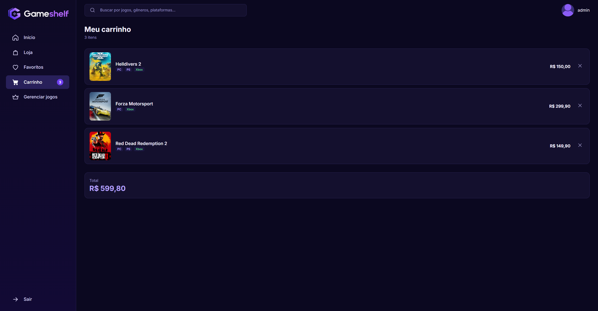
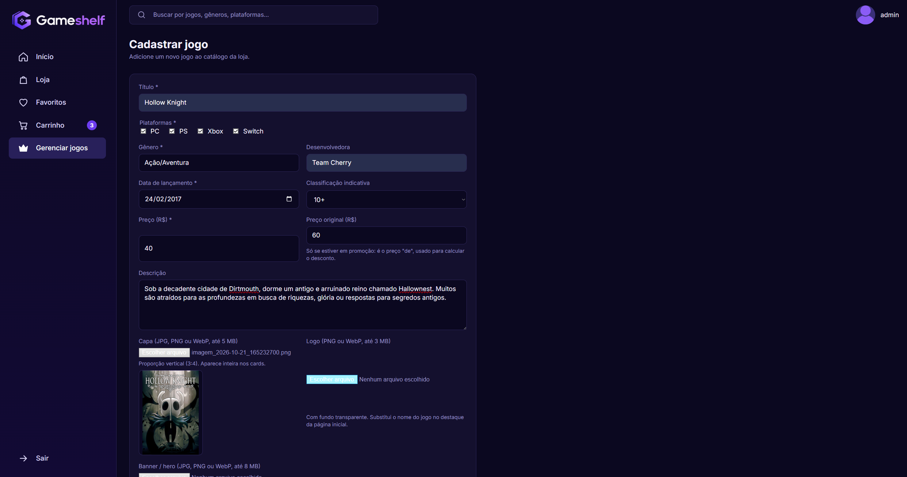

<div align="center">

# Gameshelf

**Loja virtual de jogos digitais, feita em PHP puro e PostgreSQL.**

Vitrine, busca, favoritos, carrinho e um painel para administrar o catálogo.


[**Telas**](#telas) &nbsp;·&nbsp; [**Início rápido**](#início-rápido) &nbsp;·&nbsp; [**Instalação completa**](#2-instalação-e-execução) &nbsp;·&nbsp; [**Requisitos**](#3-requisitos-funcionais) &nbsp;·&nbsp; [**Banco de dados**](#7-banco-de-dados)

<br>



</div>

---

## Sumário

1. [Sobre o projeto](#1-sobre-o-projeto) (com as [telas](#telas))
2. [Instalação e execução](#2-instalação-e-execução) (com o [início rápido](#início-rápido))
3. [Requisitos funcionais](#3-requisitos-funcionais)
4. [Regras de negócio](#4-regras-de-negócio)
5. [Requisitos não funcionais](#5-requisitos-não-funcionais)
6. [Fluxo de trabalho](#6-fluxo-de-trabalho)
7. [Banco de dados](#7-banco-de-dados)
8. [Organização do código](#8-organização-do-código)
9. [Fora do escopo da beta](#9-fora-do-escopo-da-beta)

---

## 1. Sobre o projeto

O **Gameshelf** é um **projeto escolar**: uma loja de jogos digitais construída para praticar PHP com banco de dados, do login até o CRUD completo. O cliente cria uma conta, navega pelo catálogo, favorita jogos e monta o carrinho. A equipe administra o catálogo por um painel próprio, com envio de capa, logo e banner.

Esta é a **versão beta**. O fluxo do cliente termina no carrinho: pagamento e entrega dos jogos ficam para uma versão futura. Como o produto é digital, cada jogo entra no carrinho uma única vez, sem quantidade.

### Telas

<table>
  <tr>
    <td width="50%" align="center">
      <br>
      <b>Página inicial</b><br>
      <sub>Destaque, "Em alta", "Novidades", carrinho e "Mais favoritados".</sub>
    </td>
    <td width="50%" align="center">
      <br>
      <b>Loja</b><br>
      <sub>Busca, filtros por plataforma e gênero e cinco ordenações.</sub>
    </td>
  </tr>
  <tr>
    <td width="50%" align="center">
      <br>
      <b>Página do jogo</b><br>
      <sub>Descrição, dados técnicos, desconto, favorito e carrinho.</sub>
    </td>
    <td width="50%" align="center">
      <br>
      <b>Painel do administrador</b><br>
      <sub>Lista de jogos com atalhos para editar e excluir.</sub>
    </td>
  </tr>
</table>

<details>
<summary><b>Ver mais telas</b></summary>

<br>

<table>
  <tr>
    <td width="50%" align="center">
      <br>
      <b>Página de entrada</b><br>
      <sub>O que o visitante vê antes de entrar.</sub>
    </td>
    <td width="50%" align="center">
      <br>
      <b>Carrinho</b><br>
      <sub>Itens e total, já com os descontos.</sub>
    </td>
  </tr>
  <tr>
    <td width="50%" align="center">
      <br>
      <b>Cadastro de jogo</b><br>
      <sub>Formulário com validação e prévia de capa, logo e banner.</sub>
    </td>
    </td>
  </tr>
</table>

</details>

### Quem usa o sistema

| Usuário | Como é definido | O que faz |
|---|---|---|
| **Visitante** | Não está logado | Vê a página de entrada, cria uma conta e entra. Todo o resto exige login. |
| **Cliente** | `usuarios.nivel = 0` | Vitrine, busca, filtros, favoritos e carrinho. |
| **Administrador** | `usuarios.nivel = 1` | Tudo o que o cliente faz, mais cadastrar, editar e excluir jogos. |

### Principais funcionalidades

| Área | O que existe |
|---|---|
| **Vitrine** | Página inicial com destaque, "Em alta" (maiores descontos), "Novidades" e "Mais favoritados". |
| **Loja** | Busca por título, gênero, desenvolvedora e plataforma; filtros por plataforma e gênero; cinco ordenações. |
| **Jogo** | Descrição, dados técnicos, classificação indicativa, preço e desconto. |
| **Favoritos** | Coração em qualquer card e uma página com a lista. |
| **Carrinho** | Salvo no banco: continua lá depois de sair da conta. |
| **Painel** | Cadastro, edição e exclusão de jogos, com upload de capa, logo e banner. |
| **Contas** | Senhas com hash, sessão renovada no login e contas antigas convertidas automaticamente. |

### Tecnologias

| Camada | Tecnologia | Uso |
|---|---|---|
| Backend | PHP (PDO) | Páginas, regras de negócio, sessão e upload de imagens |
| Banco | PostgreSQL | Contas, jogos, favoritos e carrinho |
| Servidor | Nginx com PHP-FPM | Publicação no servidor (localmente, o servidor embutido do PHP) |
| Front | HTML e CSS, sem framework | Telas e identidade visual (tema escuro, roxo) |
| JavaScript | Pontual, sem biblioteca | Prévia das imagens no painel e confirmação de exclusão |
| Fontes | Google Fonts | Cinzel e Inter |

O projeto não usa Composer nem npm. A única dependência é a extensão `pdo_pgsql` do PHP.

---

## 2. Instalação e execução

### Início rápido

Para só ver o site funcionando no seu computador (Linux ou macOS, com Git, PHP com `pdo_pgsql` e PostgreSQL já instalados). Cole **um bloco por vez**; o `psql` pede a senha do banco:

```bash
git clone https://github.com/gabriel-b-vitareli/gameshelf && cd gameshelf
```

```bash
sudo -u postgres psql -c "CREATE DATABASE gameshelf;" && sudo -u postgres psql -d gameshelf -f database/schema.sql && sudo -u postgres psql -d gameshelf -f database/seed.sql
```

```bash
cp includes/conexao.example.php includes/conexao.php && nano includes/conexao.php
```

```bash
php -S localhost:8000 -d upload_max_filesize=10M -d post_max_size=20M
```

Abra http://localhost:8000. Windows, servidor com Nginx, administrador e solução de problemas estão logo abaixo.

### Dois caminhos de instalação

Há dois jeitos de rodar o projeto. Escolha um:

| Caminho | Para quê | Onde fica o projeto | Endereço |
|---|---|---|---|
| **A. No seu computador** | Testar e desenvolver. Funciona em Windows, Linux e macOS. | `~/gameshelf` | http://localhost:8000 |
| **B. Num servidor Linux com Nginx** | Publicar o site (Debian ou Ubuntu). | `/var/www/gameshelf` | `http://IP-DO-SERVIDOR/` |

Os passos 1 a 3 e 5 a 6 são quase iguais nos dois caminhos; o que muda está marcado em cada passo.

> [!TIP]
> Cole **um bloco de comando por vez** e espere terminar antes do próximo. O `psql` pede a senha do banco, e uma linha colada junto seria lida como senha.

### 2.1 O que você precisa

| Programa | Versão | Observação |
|---|---|---|
| **Git** | qualquer | Para baixar o projeto (ou baixe o `.zip` e extraia). |
| **PHP** | 8 recomendado | Com a extensão `pdo_pgsql`. |
| **PostgreSQL** | qualquer atual | O cliente `psql` precisa estar disponível no terminal. |
| **Nginx** | qualquer atual | Só no caminho B, junto com o `php-fpm`. |

<details>
<summary><b>Windows:</b> como conferir os programas e ativar o <code>pdo_pgsql</code></summary>

<br>

Use o **PowerShell** (menu Iniciar, digite *PowerShell*, Enter). Cole os três comandos abaixo; cada um deve mostrar uma versão, e o do meio deve listar `pdo_pgsql`:

```powershell
git --version
```

```powershell
php -m | Select-String "pdo_pgsql"
```

```powershell
psql --version
```

Se algum disser que "não é reconhecido", o programa não está no `PATH`. Estes dois comandos tentam achá-los nas pastas padrão (valem só até fechar a janela):

```powershell
$env:Path += ";C:\xampp\php"
```

```powershell
$env:Path += ";" + (Get-ChildItem "C:\Program Files\PostgreSQL" | Sort-Object Name | Select-Object -Last 1).FullName + "\bin"
```

Se o `pdo_pgsql` não aparecer, abra o `php.ini` (para saber onde ele está, rode `php --ini`), procure as linhas `;extension=pdo_pgsql` e `;extension=pgsql` e tire o `;` do começo de cada uma. Salve e abra um PowerShell novo.

</details>

<details>
<summary><b>Linux e macOS:</b> como conferir os programas</summary>

<br>

```bash
git --version
```

```bash
php -m | grep pdo_pgsql
```

```bash
psql --version
```

No Debian ou Ubuntu, se faltar o `pdo_pgsql`: `sudo apt install php-pgsql`.

</details>

### Passo 1: baixar o projeto

**Caminho A** (Linux, macOS ou Git Bash):

```bash
cd ~ && git clone https://github.com/gabriel-b-vitareli/gameshelf && cd gameshelf
```

**Caminho A** (Windows, PowerShell):

```powershell
cd ~; git clone https://github.com/gabriel-b-vitareli/gameshelf; cd gameshelf
```

**Caminho B** (servidor):

```bash
sudo mkdir -p /var/www/gameshelf && sudo chown $USER:$USER /var/www/gameshelf && git clone https://github.com/gabriel-b-vitareli/gameshelf /var/www/gameshelf && cd /var/www/gameshelf
```

Se você baixou o `.zip`, extraia na pasta do seu caminho e entre nela pelo terminal.

> [!IMPORTANT]
> Os passos seguintes devem ser feitos **dentro da pasta do projeto**. Para conferir, rode `pwd` (ou `cd` no PowerShell): o final do caminho deve ser `gameshelf`.

### Passo 2: criar o banco de dados

Serão três comandos: criar o banco, criar as tabelas e cadastrar 17 jogos de exemplo (já com capa, logo e banner).

**Caminho A** (Windows e macOS). Cada comando pede a senha do usuário `postgres`:

```powershell
psql -U postgres -c "CREATE DATABASE gameshelf;"
```

```powershell
psql -U postgres -d gameshelf -f database/schema.sql
```

```powershell
psql -U postgres -d gameshelf -f database/seed.sql
```

**Caminho A** (Linux):

```bash
sudo -u postgres psql -c "CREATE DATABASE gameshelf;"
```

```bash
sudo -u postgres psql -d gameshelf -f database/schema.sql
```

```bash
sudo -u postgres psql -d gameshelf -f database/seed.sql
```

**Caminho B** (servidor). Aqui o site usa um usuário próprio, em vez do superusuário `postgres`. Troque `troque-esta-senha` por uma senha de verdade e anote-a para o passo 3:

```bash
sudo -u postgres psql -c "CREATE USER gameshelf WITH PASSWORD 'troque-esta-senha';"
```

```bash
sudo -u postgres psql -c "CREATE DATABASE gameshelf OWNER gameshelf;"
```

```bash
psql -h localhost -U gameshelf -d gameshelf -f database/schema.sql
```

```bash
psql -h localhost -U gameshelf -d gameshelf -f database/seed.sql
```

> [!WARNING]
> Rode o `seed.sql` **uma única (ou nenhuma, se preferir) vez**. Ele não verifica duplicidade, então rodar de novo repete os jogos. O `schema.sql`, ao contrário, pode ser rodado quantas vezes quiser sem apagar dados.

> [!NOTE]
> **Prefere o pgAdmin?** Clique com o botão direito em *Databases*, *Create*, *Database*, dê o nome `gameshelf` e salve. Depois abra o *Query Tool* nesse banco, carregue `database/schema.sql` e execute (F5). Repita com `database/seed.sql`.

### Passo 3: configurar a conexão com o banco

O arquivo `includes/conexao.php` não vem no projeto: ele fica fora do Git para a sua senha não ser publicada. Você o cria a partir do modelo.

**Windows:**

```powershell
Copy-Item includes\conexao.example.php includes\conexao.php
```

```powershell
notepad includes\conexao.php
```

**Linux e macOS:**

```bash
cp includes/conexao.example.php includes/conexao.php
```

```bash
nano includes/conexao.php
```

Troque os dados do começo do arquivo pelos do seu PostgreSQL:

```php
$host   = "localhost";
$dbname = "gameshelf";
$user   = "seu_usuario";
$pass   = "sua_senha";
```

| Campo | O que colocar |
|---|---|
| `$host` | `localhost` serve quando o banco está no mesmo computador. Se estiver em outra máquina, use o IP dela. A conexão usa a porta padrão do PostgreSQL (5432); para outra porta, acrescente `port=NUMERO;` na string `pgsql:` do `conexao.php`. |
| `$dbname` | `gameshelf`, o banco criado no passo 2. |
| `$user`, `$pass` | **Caminho A:** `postgres` e a senha que você definiu ao instalar o PostgreSQL. **Caminho B:** `gameshelf` e a senha do passo 2. |

Salve o arquivo (no Notepad, Ctrl+S; no nano, Ctrl+O, Enter e Ctrl+X).

### Passo 4: iniciar o site

#### Caminho A: servidor embutido do PHP

Dentro da pasta do projeto:

```bash
php -S localhost:8000 -d upload_max_filesize=10M -d post_max_size=20M
```

Abra http://localhost:8000 no navegador. Deixe o terminal aberto enquanto usa o site; para parar, aperte `Ctrl+C`.

As duas opções `-d` aumentam os limites de upload só para esta execução, para o painel aceitar capas e banners grandes sem mexer no `php.ini`.

#### Caminho B: servidor Linux com Nginx e PHP-FPM

Esta parte é a mais longa, mas cada bloco faz uma coisa só. Use o **mesmo terminal** do começo ao fim (a variável `PHP_V` do passo B2 se perde se você fechá-lo).

**B1. Instale os pacotes:**

```bash
sudo apt update && sudo apt install -y nginx php-fpm php-pgsql postgresql git
```

**B2. Descubra a versão do PHP instalada.** Os próximos comandos usam essa versão, então você não precisa saber qual é:

```bash
PHP_V=$(php -r 'echo PHP_MAJOR_VERSION.".".PHP_MINOR_VERSION;') && echo "PHP $PHP_V"
```

Deve aparecer algo como `PHP 8.3`.

**B3. Aumente os limites de upload do PHP** (capa de até 5 MB, logo de até 3 MB e banner de até 8 MB):

```bash
sudo sed -i 's/^upload_max_filesize = .*/upload_max_filesize = 10M/' /etc/php/$PHP_V/fpm/php.ini
```

```bash
sudo sed -i 's/^post_max_size = .*/post_max_size = 20M/' /etc/php/$PHP_V/fpm/php.ini
```

```bash
sudo systemctl restart php$PHP_V-fpm
```

**B4. Crie a configuração do site no Nginx.** Este bloco grava o arquivo `/etc/nginx/sites-available/gameshelf`:

```bash
sudo tee /etc/nginx/sites-available/gameshelf > /dev/null <<'EOF'
server {
    listen 80 default_server;
    server_name _;

    root /var/www/gameshelf;
    index index.php;

    # O Nginx limita o envio a 1 MB por padrão; o painel precisa de mais.
    client_max_body_size 20M;

    # Pastas e arquivos que nunca devem ser baixados pelo navegador.
    location ~ ^/(database|documentacao|includes)/ { deny all; }
    location ~ /\.                                 { deny all; }

    # Imagens enviadas nunca podem ser executadas como PHP.
    location ~ ^/uploads/.*\.php$ { deny all; }

    location / {
        try_files $uri $uri/ =404;
    }

    location ~ \.php$ {
        include snippets/fastcgi-php.conf;
        fastcgi_pass unix:/run/php/phpPHPVER-fpm.sock;
    }
}
EOF
```

Agora troque o `PHPVER` do arquivo pela versão que você descobriu no B2:

```bash
sudo sed -i "s/PHPVER/$PHP_V/" /etc/nginx/sites-available/gameshelf
```

**B5. Ative o site, desative o site padrão do Nginx e teste a configuração:**

```bash
sudo ln -sf /etc/nginx/sites-available/gameshelf /etc/nginx/sites-enabled/gameshelf
```

```bash
sudo rm -f /etc/nginx/sites-enabled/default
```

```bash
sudo nginx -t
```

O último comando deve terminar com `syntax is ok` e `test is successful`. Se mostrar um erro, ele diz a linha do problema no arquivo.

**B6. Dê ao PHP permissão de gravar na pasta de uploads** (sem isso o envio de imagens falha):

```bash
sudo chown -R www-data:www-data /var/www/gameshelf/uploads
```

**B7. Recarregue o Nginx e descubra o endereço do site:**

```bash
sudo systemctl reload nginx
```

```bash
echo "http://$(hostname -I | awk '{print $1}')/"
```

Abra o endereço que apareceu no navegador. Se ele não abrir de outra máquina, libere a porta 80 no firewall: `sudo ufw allow 'Nginx HTTP'`.

> O código descobre sozinho em que endereço está (veja a [seção 6.4](#64-como-os-endereços-funcionam-base_url)), então nada precisa ser configurado se o site ficar na raiz, como acima. A configuração do Nginx também bloqueia o acesso direto às pastas `database/`, `documentacao/` e `includes/`.

> O **Apache** também funciona sem mudar nada no código; a configuração do Nginx acima é só o que usamos neste projeto.

**Deu certo se** a página de entrada abre com o banner do Gameshelf e, depois de criar uma conta e entrar, a loja mostra os 17 jogos de exemplo, com o **Helldivers 2** em destaque na página inicial.

### Passo 5: criar o primeiro administrador

Toda conta nova nasce como cliente. Crie a sua pelo site (botão **Criar conta grátis**) e depois troque o nível dela direto no banco. Troque `seu_usuario` pelo nome que você escolheu.

**Windows e macOS:**

```powershell
psql -U postgres -d gameshelf -c "UPDATE usuarios SET nivel = 1 WHERE usuario = 'seu_usuario';"
```

**Linux (caminho A):**

```bash
sudo -u postgres psql -d gameshelf -c "UPDATE usuarios SET nivel = 1 WHERE usuario = 'seu_usuario';"
```

**Caminho B:**

```bash
psql -h localhost -U gameshelf -d gameshelf -c "UPDATE usuarios SET nivel = 1 WHERE usuario = 'seu_usuario';"
```

Recarregue qualquer página da loja: o item **Gerenciar jogos** aparece no menu lateral. Não existe tela para promover outras contas; para isso, repita o comando com o outro usuário.

### Passo 6: imagens dos jogos

Nada a fazer aqui para o básico: os 17 jogos de exemplo já vêm ligados a uma **capa, uma logo e um banner padrão**, que acompanham o repositório em `uploads/capas/`, `uploads/logos/` e `uploads/heros/` (arquivos com nome `padrao-<jogo>.jpg` ou `.png`). A lista completa está em [`documentacao/imagens-padrao.md`](documentacao/imagens-padrao.md).

Para trocar ou acrescentar imagens, há dois jeitos:

- **Pelo painel (recomendado):** entre como administrador, abra *Gerenciar jogos*, clique em **Editar** no jogo e envie capa, logo e banner.
- **Por SQL:** aponte o nome de um arquivo que já esteja em `uploads/capas/`, ou um link `http(s)://` completo:

  ```sql
  UPDATE jogos SET capa = 'elden-ring.jpg' WHERE titulo = 'Elden Ring';
  ```

| Imagem | Pasta | Formatos | Limite | Onde aparece |
|---|---|---|---|---|
| Capa | `uploads/capas/` | JPG, PNG, WebP | 5 MB | cards, página do jogo, carrinho |
| Logo | `uploads/logos/` | PNG, WebP (fundo transparente) | 3 MB | destaque da página inicial, no lugar do título |
| Banner | `uploads/heros/` | JPG, PNG, WebP | 8 MB | fundo do destaque da página inicial |

**Imagens padrão x uploads do painel.** O que o painel envia recebe um nome aleatório e **não vai para o Git** (veja `uploads/.gitignore`). Só os arquivos que começam com `padrao-` são versionados. **Atenção:** o painel **ainda não** protege essas imagens. Excluir um jogo de exemplo, ou trocar a imagem dele, apaga o arquivo `padrao-*` do disco. Para recuperá-lo, restaure-o pelo Git (`git checkout -- uploads/`). As pastas `capas/`, `logos/` e `heros/` são criadas sozinhas, se não existirem, no primeiro envio.

> [!NOTE]
> Se a imagem padrão de um jogo ainda não tiver sido adicionada à pasta, o card mostra uma imagem quebrada. Para conferir o que falta, use o comando de [`documentacao/imagens-padrao.md`](documentacao/imagens-padrao.md#conferir-o-que-falta).

### 2.2 Se algo der errado

| O que aparece | Causa provável | O que fazer |
|---|---|---|
| `php`, `psql` ou `git` "não é reconhecido" (Windows) | O Windows não sabe onde está o programa | Veja a seção "Windows" em [2.1](#21-o-que-você-precisa). |
| `could not find driver` | Falta a extensão `pdo_pgsql` | Ative-a (Windows) ou instale `php-pgsql` (Linux), depois reinicie o servidor. |
| `Erro: ...` (mensagem do PDO, no topo da página) | O PHP não falou com o banco | Confira os dados do `includes/conexao.php` (passo 3) e se o PostgreSQL está ligado. |
| Erro dizendo que `conexao.php` não existe | O arquivo de conexão não foi criado | Faça o passo 3. |
| **502 Bad Gateway** (Nginx) | O Nginx não achou o PHP-FPM | Rode `ls /run/php/` e confira se o nome do arquivo `.sock` é o mesmo da linha `fastcgi_pass` em `/etc/nginx/sites-available/gameshelf`. Veja também se o serviço está ativo: `sudo systemctl status php$PHP_V-fpm`. |
| **404 Not Found** em todas as páginas (Nginx) | O `root` da configuração está errado | Confira se `/var/www/gameshelf/index.php` existe e se a linha `root` aponta para essa pasta. |
| **403 Forbidden** em `/database/`, `/includes/` ou `/documentacao/` | É proposital | O Nginx bloqueia o acesso direto a essas pastas. |
| **413 Request Entity Too Large** ao enviar imagem | O limite de envio do Nginx | Confira o `client_max_body_size 20M;` no arquivo do site e recarregue o Nginx. |
| Envio de imagem falha, sem erro de tamanho | O PHP não pode gravar em `uploads/` | Rode o `chown` do passo B6. |
| Imagem recusada por "limite do servidor" | Limites do PHP baixos | No caminho A, use as opções `-d` do passo 4; no B, refaça o passo B3. |
| Página sem estilo, ou links quebrados | A detecção automática do endereço falhou (proxy reverso, `Alias` incomum) | Crie `includes/config.local.php` com `<?php define('BASE_URL', '/gameshelf');` (use `''` se o projeto estiver na raiz). |
| Jogos duplicados na loja | O `seed.sql` foi rodado mais de uma vez | Apague os repetidos pelo painel, ou recrie o banco do zero. |
| O item "Gerenciar jogos" não aparece | A conta ainda é cliente | Faça o passo 5 e recarregue a página. |
| "Sua sessão do formulário expirou" | O token do formulário não bateu | Recarregue a página do formulário e tente de novo. |
| Alterações no CSS não aparecem | O navegador guardou a versão antiga | Aperte `Ctrl+F5`. |

Para ver a mensagem real de um erro 500, consulte o log:

```bash
sudo tail -n 20 /var/log/nginx/error.log
```

```bash
sudo tail -n 20 /var/log/php$PHP_V-fpm.log
```

---

## 3. Requisitos funcionais

A lista completa, com prioridades, também está em [`documentacao/requisitos.md`](documentacao/requisitos.md).

### Conta e acesso

| Código | Requisito | Quem usa | Onde |
|---|---|---|---|
| **RF01** | Criar conta com nome de usuário, senha e confirmação de senha. | Visitante | `login/cadastrar.php` |
| **RF02** | Validar o cadastro: usuário de 3 a 30 caracteres (letras, números, ponto, hífen e underline), único sem diferenciar maiúsculas de minúsculas; senha com no mínimo 6 caracteres que bata com a confirmação. | Visitante | `login/cadastrar.php` |
| **RF03** | Entrar com usuário e senha. Usuário inexistente e senha errada mostram a mesma mensagem. | Visitante | `login/login.php` |
| **RF04** | Sair da conta pelo botão "Sair" do menu. | Cliente, admin | `login/logout.php` |
| **RF05** | Restringir as páginas internas a quem está logado; os demais vão para o login. | Todos | `login/verifica-login.php` |

### Vitrine

| Código | Requisito | Quem usa | Onde |
|---|---|---|---|
| **RF06** | Página inicial com o jogo em destaque, "Em alta", "Novidades", "Mais favoritados" e o resumo do carrinho. | Cliente, admin | `pages/inicial.php` |
| **RF07** | Listar todos os jogos do catálogo em cards com capa, plataformas, título e preço (com desconto, quando houver). | Cliente, admin | `pages/loja.php` |
| **RF08** | Pesquisar por título, gênero, desenvolvedora ou plataforma, sem diferenciar maiúsculas de minúsculas. A busca fica no topo de todas as páginas internas. | Cliente, admin | `includes/header.php`, `pages/loja.php` |
| **RF09** | Filtrar por plataforma (PC, PS, Xbox ou Switch). | Cliente, admin | `pages/loja.php` |
| **RF10** | Filtrar por gênero, entre os que existem no catálogo. | Cliente, admin | `pages/loja.php` |
| **RF11** | Ordenar por mais populares, lançamentos, menor preço, maior preço ou nome (A-Z). | Cliente, admin | `pages/loja.php` |
| **RF12** | Ver os detalhes de um jogo: capa, plataformas, descrição, gênero, desenvolvedora, data de lançamento, classificação indicativa, preço e percentual de desconto. | Cliente, admin | `pages/jogo.php` |
| **RF13** | Marcar com "Lançamento" os jogos lançados nos últimos 90 dias, nas Novidades. | Cliente, admin | `includes/componentes.php` |

### Favoritos

| Código | Requisito | Quem usa | Onde |
|---|---|---|---|
| **RF14** | Favoritar ou desfavoritar um jogo pelo coração, em qualquer card ou na página do jogo. | Cliente, admin | `acoes/favoritos.php` |
| **RF15** | Listar os jogos favoritos, dos mais recentes para os mais antigos. | Cliente, admin | `pages/favoritos.php` |

### Carrinho

| Código | Requisito | Quem usa | Onde |
|---|---|---|---|
| **RF16** | Adicionar um jogo ao carrinho pela página do jogo ou pelo destaque da página inicial. Adicionar de novo não duplica o item. | Cliente, admin | `acoes/carrinho.php` |
| **RF17** | Remover um jogo pela página do carrinho ou pelo resumo lateral da página inicial. | Cliente, admin | `acoes/carrinho.php` |
| **RF18** | Ver o carrinho com a lista de itens e o total. | Cliente, admin | `pages/carrinho.php` |
| **RF19** | Mostrar no menu lateral a quantidade de itens do carrinho, em todas as páginas internas. | Cliente, admin | `includes/header.php` |

### Administração (nível 1)

| Código | Requisito | Quem usa | Onde |
|---|---|---|---|
| **RF20** | Listar todos os jogos, com atalhos para editar e excluir. | Admin | `pages/gerenciar-jogos.php` |
| **RF21** | Cadastrar um jogo: título, plataformas, gênero, desenvolvedora, lançamento, classificação, preço, preço original, descrição e destaque. | Admin | `pages/cadastrar-game.php` |
| **RF22** | Enviar capa, logo e banner no cadastro (todos opcionais). | Admin | `pages/cadastrar-game.php` |
| **RF23** | Editar todos os dados de um jogo já cadastrado. | Admin | `pages/editar-jogo.php` |
| **RF24** | Trocar capa, logo e banner na edição. Campo em branco mantém a imagem atual; a imagem substituída é apagada do disco. | Admin | `pages/editar-jogo.php` |
| **RF25** | Excluir um jogo, com confirmação. Favoritos, itens de carrinho e imagens dele também são apagados. | Admin | `pages/gerenciar-jogos.php` |
| **RF26** | Validar os campos do jogo antes de salvar, com mensagens de erro e os campos preenchidos de volta. | Admin | `pages/cadastrar-game.php`, `pages/editar-jogo.php` |

---

## 4. Regras de negócio

### Contas e acesso

| Código | Regra |
|---|---|
| **RN01** | Toda conta nasce como **cliente** (`nivel = 0`). Não existe tela para mudar o nível: o primeiro administrador, e os seguintes, são definidos direto no banco por SQL. |
| **RN02** | O nome de usuário é único sem diferenciar maiúsculas de minúsculas: `Ana` e `ana` contam como o mesmo usuário. |
| **RN03** | O usuário tem de 3 a 30 caracteres entre letras, números, ponto, hífen e underline. A senha precisa de pelo menos 6 caracteres e deve ser igual à confirmação. |
| **RN04** | O erro de login é sempre "Usuário ou senha incorretos.", para que ninguém descubra quais usuários existem. |
| **RN05** | Só a página de entrada (`index.php`), o login e o cadastro são públicos. Todas as demais páginas redirecionam o visitante para o login. |
| **RN06** | Quem já está logado e abre a página de entrada, o login ou o cadastro volta para a página inicial da loja. |
| **RN07** | O nível de acesso é conferido no banco a cada página aberta: uma mudança de nível vale na hora, e uma conta que foi apagada é deslogada. |
| **RN08** | Quem não é administrador recebe um 404 comum nas páginas do painel, sem aviso de "acesso negado", e esses links nem aparecem no menu. |

### Catálogo

| Código | Regra |
|---|---|
| **RN09** | Um jogo está em promoção quando o `preco_original` é maior que o `preco`. Só então o site mostra o preço "de", o percentual de desconto e o jogo entra em "Em alta". |
| **RN10** | "Em alta" mostra os jogos em promoção, do maior para o menor desconto percentual. |
| **RN11** | O destaque da página inicial é o jogo marcado como `destaque` de lançamento mais recente. Se nenhum estiver marcado, vale o lançamento mais recente do catálogo. |
| **RN12** | Jogos lançados nos últimos 90 dias recebem a marca "Lançamento" nos cards das Novidades. |
| **RN13** | A popularidade de um jogo é o número de pessoas que o favoritaram. Ela define a ordenação "Mais populares" e o painel "Mais favoritados". |
| **RN14** | Plataformas aceitas: PC, PS, Xbox e Switch (um jogo pode ter várias). Classificações indicativas aceitas: Livre, 10, 12, 14, 16 e 18. |
| **RN15** | Para salvar um jogo é obrigatório ter título (até 100 caracteres), ao menos uma plataforma, gênero (até 50 caracteres), data de lançamento válida e preço válido. O preço original, se informado, precisa ser maior que o preço atual. |
| **RN16** | O preço aceita vírgula ou ponto (`199,90` ou `199.90`) e precisa estar entre 0 e 99.999.999,99. |

### Favoritos e carrinho

| Código | Regra |
|---|---|
| **RN17** | Favoritar um jogo que já é favorito o remove da lista: o mesmo botão liga e desliga. |
| **RN18** | O jogo é digital, então o carrinho tem um de cada, sem quantidade. Adicionar o mesmo jogo de novo não faz nada. |
| **RN19** | Só entra no carrinho um jogo que existe no catálogo. |
| **RN20** | O total do carrinho é a soma dos preços atuais dos jogos nele, já com o desconto. |
| **RN21** | O carrinho e os favoritos ficam no banco, ligados à conta, e não na sessão: continuam lá depois de sair. |

### Administração

| Código | Regra |
|---|---|
| **RN22** | Cada jogo tem três imagens opcionais: capa (JPG, PNG ou WebP, até 5 MB), logo (PNG ou WebP, até 3 MB, para ter fundo transparente) e banner (JPG, PNG ou WebP, até 8 MB). |
| **RN23** | Sem capa, o card mostra o título do jogo no lugar da imagem. Sem logo, o destaque da página inicial mostra o título em texto. |
| **RN24** | Na edição, campo de imagem em branco mantém a imagem atual. Ao trocar, a imagem antiga é apagada do disco, mas só depois de o banco confirmar a alteração. |
| **RN25** | Excluir um jogo apaga também os favoritos e os itens de carrinho dele (por `ON DELETE CASCADE`) e as imagens dele no disco. Imagens que são link `http(s)://` não são tocadas. As imagens padrão (`padrao-*`) **também são apagadas do disco** (proteção ainda não implementada). |
| **RN26** | Excluir é sempre uma ação confirmada pelo administrador, enviada por formulário `POST` com token CSRF, nunca por um simples link. |
| **RN27** | Se o banco falhar depois do upload, as imagens recém-gravadas são apagadas, para não sobrar arquivo órfão. |

---

## 5. Requisitos não funcionais

| Código | Categoria | Requisito | Como é atendido |
|---|---|---|---|
| **RNF01** | Tecnologia | PHP puro com PDO e banco relacional PostgreSQL. | Sem framework e sem Composer; conexão em `includes/conexao.php`. |
| **RNF02** | Segurança | As senhas nunca são guardadas como foram digitadas. | `password_hash()` no cadastro e `password_verify()` no login. Contas antigas em texto puro entram uma última vez e são convertidas (`verificarSenha()`). |
| **RNF03** | Segurança | Nada do que o usuário digita é executado como SQL. | Todas as consultas usam `prepare` com parâmetros. A ordenação é escolhida entre textos fixos, nunca montada com texto do usuário. |
| **RNF04** | Segurança | Nenhum texto cadastrado é executado como código na página (XSS). | Todo texto vindo do banco ou do usuário passa pela função `e()` (`htmlspecialchars`) antes de ir para o HTML. |
| **RNF05** | Segurança | Ações do administrador não podem ser disparadas por outro site (CSRF). | Os formulários do painel levam um token de sessão conferido com `hash_equals()`. As alterações do cliente (favoritar, carrinho) só aceitam `POST`. |
| **RNF06** | Controle de acesso | Páginas restritas só abrem para quem pode usá-las. | `login/verifica-login.php` no topo das páginas internas e `includes/admin-nivel1.php` nas do painel, que respondem 404 a quem não é nível 1. |
| **RNF07** | Segurança | O login não revela se um usuário existe e a sessão é renovada. | Mesma mensagem para usuário e senha errados; `session_regenerate_id(true)` a cada login. |
| **RNF08** | Segurança | Redirecionamentos pós-ação não levam para fora do site. | `urlSegura()` só aceita caminhos internos do projeto. |
| **RNF09** | Segurança | O upload aceita só imagens de verdade. | O tipo é conferido pelo conteúdo do arquivo (`getimagesize`), não pela extensão; tipo e tamanho são limitados; o arquivo recebe nome aleatório; no Nginx, PHP dentro de `uploads/` não é executado. |
| **RNF10** | Integridade | Dados inválidos não chegam ao banco. | Validação no servidor antes de gravar, mais chaves primárias, chaves estrangeiras com `ON DELETE CASCADE` e restrições `NOT NULL` e `UNIQUE`. |
| **RNF11** | Usabilidade | O usuário entende o que aconteceu e não perde o que digitou. | Mensagens de erro nos formulários, campos preenchidos de volta, avisos de ação ("Jogo adicionado ao carrinho") e confirmação antes de excluir. |
| **RNF12** | Usabilidade | O administrador vê como a imagem vai ficar antes de salvar. | Prévia das imagens nos formulários de cadastro e edição. |
| **RNF13** | Manutenibilidade | O código é fácil de ler e de alterar. | Código separado por responsabilidade (`login/`, `pages/`, `acoes/`, `includes/`, `database/`, `style/`); consultas em `functions.php`; HTML repetido em `componentes.php`; upload em `imagens.php`. |
| **RNF14** | Portabilidade | Roda na raiz do site ou numa subpasta, sem configurar nada. | O endereço base é descoberto sozinho em `includes/config.php` e todo link passa por `url()`. |
| **RNF15** | Portabilidade | Roda com o servidor embutido do PHP. | `php -S localhost:8000` e PostgreSQL, sem dependências além de `pdo_pgsql`. |
| **RNF16** | Responsividade | A interface se adapta a computadores, tablets e celulares. | CSS com `@media` nas quatro folhas de estilo. |
| **RNF17** | Identidade visual | Tema escuro voltado ao universo dos videogames. | Paleta descrita em [`documentacao/paleta-cores.md`](documentacao/paleta-cores.md). |

---

## 6. Fluxo de trabalho

### 6.1 Cliente

```text
 Página de entrada (index.php)
        │
        ├─► "Criar conta grátis" ──► Cadastro ──► Login (com aviso "Conta criada!")
        │
        └─► "Já tenho uma conta" ──► Login
                                        │
                                        ▼
                               Página inicial da loja
                       (destaque, Em alta, Novidades, Mais favoritados)
                                        │
          ┌───────────────┬─────────────┴─────────────┬────────────────┐
          ▼               ▼                           ▼                ▼
        Loja          Favoritos                   Carrinho          Sair
   (busca, filtros,   (lista dos                  (itens e total,   (encerra a
    ordenação)         corações)                   remover)          sessão)
          │
          ▼
   Página do jogo ──► coração (favoritar) ou "Adicionar ao carrinho"
```

O menu lateral é igual em todas as páginas internas: Início, Loja, Favoritos, Carrinho (com o contador de itens) e Sair. A busca fica no topo, também em todas elas, e leva para a loja já filtrada.

### 6.2 Administrador

O administrador entra pela mesma tela de login. Para ele, aparece no menu o item **Gerenciar jogos**, que leva ao painel:

```text
 Gerenciar jogos (lista de todos os jogos)
        │
        ├─► "Cadastrar jogo" ──► formulário ──► validação ──► imagens salvas ──► jogo gravado
        │                                                                          │
        │                                                           abre a página do jogo novo
        │
        ├─► "Editar" ──► formulário preenchido ──► altera dados, troca imagens ──► volta à lista
        │
        └─► "Excluir" ──► confirmação do navegador ──► jogo, favoritos, carrinhos e imagens apagados
```

| Tela | Fluxo |
|---|---|
| **Gerenciar jogos** | Lista todos os jogos por ordem alfabética, com capa, gênero, plataformas e preço, e os botões Editar e Excluir. |
| **Cadastrar jogo** | Preenche os dados, escolhe plataformas, classificação e imagens opcionais e salva. Se houver erro, a lista de problemas aparece e nada do que foi digitado se perde. |
| **Editar jogo** | O formulário já vem preenchido, com as imagens atuais. Campos de imagem em branco mantêm o que já existe. |
| **Excluir** | Pede confirmação, apaga o jogo e as imagens dele do disco e volta para a lista com um aviso. |

### 6.3 Como uma página funciona por dentro

Toda página interna segue o mesmo caminho, do pedido do navegador até o HTML pronto:

```text
 Navegador ──► pages/loja.php
                 1. login/verifica-login.php   confere se há sessão (senão, vai para o login)
                 2. lê e valida os filtros     (GET conferido contra listas permitidas)
                 3. includes/functions.php     busca os dados no banco (listarJogos, idsFavoritos...)
                 4. includes/header.php        abre o HTML: menu lateral, busca e usuário
                 5. HTML da página             usa os dados e os componentes (cardJogo...)
                 6. includes/footer.php        fecha o HTML
                        │
                        ▼
                 HTML completo ──► Navegador
```

As páginas do painel começam com `includes/admin-nivel1.php` no lugar do passo 1: ele inclui a verificação de login e ainda confere o nível no banco.

As ações que não têm tela própria (`acoes/favoritos.php` e `acoes/carrinho.php`) recebem um `POST`, fazem o trabalho, guardam um aviso na sessão (`flash()`) e **redirecionam** de volta para a página de origem. Assim, apertar F5 depois não repete a ação (padrão *POST, Redirect, GET*). O aviso aparece uma vez e some.

### 6.4 Como os endereços funcionam (`BASE_URL`)

Num servidor, o projeto às vezes fica numa subpasta (`http://servidor/gameshelf/`), e um link escrito como `/pages/loja.php` quebraria. Por isso nenhum endereço do código começa com `/`: tudo passa por `url('pages/loja.php')`, que acrescenta a subpasta quando ela existir.

A subpasta (`BASE_URL`) é descoberta sozinha por `includes/config.php`, nesta ordem:

```text
 1. Variável de ambiente GAMESHELF_BASE_URL     (se existir, vale ela)
 2. Comparar o caminho do script no disco com o endereço dele na web
        disco: /var/www/html/gameshelf/pages/loja.php
        web:   /gameshelf/pages/loja.php        ──►  BASE_URL = /gameshelf
 3. Posição do projeto dentro da raiz de documentos do servidor
 4. Último recurso: raiz do site                (BASE_URL = '')
```

Se a detecção falhar (proxy reverso, `Alias` incomum), crie `includes/config.local.php` com o valor certo. Esse arquivo não vai para o Git:

```php
<?php define('BASE_URL', '/gameshelf');   // use '' se o projeto estiver na raiz
```

---

## 7. Banco de dados

A estrutura completa está em [`database/schema.sql`](database/schema.sql) e a descrição detalhada de cada coluna em [`documentacao/banco.md`](documentacao/banco.md).

```text
  usuarios                      favoritos                        jogos
 ┌──────────────────┐     ┌───────────────────┐        ┌──────────────────────┐
 │ id          PK   │◄────│ usuario_id   FK   │        │ id             PK    │
 │ usuario  UNIQUE  │     │ jogo_id      FK   │───────►│ titulo               │
 │ senha  (hash)    │     │ criado_em         │        │ capa, logo, hero     │
 │ nivel  (0 ou 1)  │     │ PK (usuario_id,   │        │ plataforma           │
 └──────────────────┘     │     jogo_id)      │        │ genero               │
          ▲               └───────────────────┘        │ desenvolvedora       │
          │                                            │ lancamento           │
          │               ┌───────────────────┐        │ descricao            │
          └───────────────│ carrinho          │        │ idade                │
                          │ usuario_id   FK   │        │ preco                │
                          │ jogo_id      FK   │───────►│ preco_original       │
                          │ criado_em         │        │ destaque             │
                          │ PK (usuario_id,   │        └──────────────────────┘
                          │     jogo_id)      │
                          └───────────────────┘
                          ON DELETE CASCADE nos dois lados
```

| Tabela | Guarda | Destaques |
|---|---|---|
| `usuarios` | As contas | `usuario` único; `senha` guarda só o hash (bcrypt), por isso 255 caracteres; `nivel` é `0` (cliente, padrão) ou `1` (administrador). |
| `jogos` | O catálogo | `plataforma` é uma lista separada por vírgula, sem espaço (`PC,PS,Xbox`); `idade` é a classificação indicativa; `preco_original` maior que `preco` ativa o desconto; `destaque` marca o jogo do topo da página inicial; `capa`, `logo` e `hero` guardam o nome do arquivo em `uploads/` ou um link `http(s)://`. |
| `favoritos` | Uma linha por jogo favoritado de cada conta | A chave (`usuario_id`, `jogo_id`) impede favoritar o mesmo jogo duas vezes. A contagem de linhas por jogo define a popularidade. |
| `carrinho` | Uma linha por jogo no carrinho de cada conta | A mesma chave composta impede repetição. Sem coluna de quantidade, porque o jogo é digital. |

Apagar uma conta ou um jogo apaga as linhas ligadas a ele em `favoritos` e `carrinho`.

### Arquivos SQL

| Arquivo | Para que serve |
|---|---|
| `database/schema.sql` | Cria as tabelas. Pode ser rodado em banco novo ou em cima de um banco existente: usa `IF NOT EXISTS` e, no fim, remove as colunas antigas de avaliação, estoque e vendas (bloco "Limpeza da versão beta"). |
| `database/seed.sql` | Insere 17 jogos de exemplo (Helldivers 2 em destaque), cada um com capa, logo e banner padrão de `uploads/`. **Rode uma única vez**, porque ele não verifica duplicidade. |
| `database/backup_gameshelf.sql` | Backup do banco usado no desenvolvimento, incluído no repositório **a pedido do professor**. Ele tem a estrutura da versão anterior à beta (com as colunas `nota`, `estoque` e `vendas`), por isso a instalação usa o `schema.sql` e o `seed.sql`. |

---

## 8. Organização do código

O projeto separa o que decide o que fazer (consultas, validação, sessão) do que só mostra o resultado (HTML e CSS). Cada pasta tem uma responsabilidade:

```text
gameshelf/
├── index.php                 página de entrada (landing page)
├── login/
│   ├── login.php             tela e lógica de login
│   ├── cadastrar.php         tela e lógica de criar conta
│   ├── logout.php            encerra a sessão
│   └── verifica-login.php    barreira de acesso, incluída no topo das páginas internas
├── pages/                    páginas internas
│   ├── inicial.php           página inicial da loja
│   ├── loja.php              vitrine com busca, filtros e ordenação
│   ├── jogo.php              página de um jogo
│   ├── favoritos.php         lista de favoritos
│   ├── carrinho.php          carrinho
│   ├── gerenciar-jogos.php   [admin] lista e exclui
│   ├── cadastrar-game.php    [admin] cadastro de jogo
│   └── editar-jogo.php       [admin] edição de jogo
├── acoes/                    recebem POST, fazem o trabalho e redirecionam
│   ├── favoritos.php         favorita ou desfavorita
│   └── carrinho.php          adiciona ou remove do carrinho
├── includes/
│   ├── config.php            BASE_URL (detecção automática) e url()
│   ├── conexao.example.php   modelo da conexão com o banco
│   ├── conexao.php           sua conexão (você cria; fica fora do Git)
│   ├── config.local.php      ajuste manual opcional do BASE_URL (fora do Git)
│   ├── functions.php         helpers, consultas ao banco e regras de negócio
│   ├── componentes.php       HTML reutilizável: cards, preço, plataformas, avisos
│   ├── imagens.php           validação, gravação e remoção de imagens; leitura de preço
│   ├── admin-nivel1.php      barreira de acesso do painel (404 para quem não é admin)
│   ├── header.php            topo padrão: abre o HTML, menu lateral e busca
│   ├── footer.php            fecha o HTML
│   └── icones.php            ícones em SVG usados pelo menu e pelos cards
├── database/
│   ├── schema.sql            criação das tabelas
│   ├── seed.sql              17 jogos de exemplo, com imagens padrão
│   └── backup_gameshelf.sql  backup do banco (entrega pedida pelo professor)
├── style/
│   ├── global.css            página de entrada
│   ├── login.css             login e cadastro
│   ├── homepage.css          base visual das páginas internas
│   └── app.css               complementos das páginas internas e do painel
├── uploads/
│   ├── (logos do site e ícones)
│   ├── capas/                capas: padrao-*.jpg (no Git) + enviadas pelo admin (fora do Git)
│   ├── logos/                logos: padrao-*.png (no Git) + enviadas pelo admin (fora do Git)
│   └── heros/                banners: padrao-*.jpg (no Git) + enviados pelo admin (fora do Git)
└── documentacao/
    ├── requisitos.md         requisitos funcionais e não funcionais, com prioridades
    ├── banco.md              tabelas e colunas em detalhe
    ├── imagens-padrao.md     lista das imagens padrão dos jogos de exemplo
    ├── paleta-cores.md       cores da identidade visual
    └── img/                  capturas de tela usadas neste README
```

### Funções principais

| Arquivo | Função | O que faz |
|---|---|---|
| `functions.php` | `e($valor)` | Escapa texto antes de ir para o HTML (proteção contra XSS). |
| | `moeda($valor)` | Formata como `R$ 199,90`. |
| | `percentualDesconto($jogo)` | Calcula o desconto em % a partir de `preco` e `preco_original`. |
| | `ehLancamento($jogo)` | Diz se o jogo saiu nos últimos 90 dias. |
| | `listaPlataformas($jogo)` | Transforma `PC,PS` em uma lista. |
| | `capaUrl()`, `logoUrl()`, `heroUrl()` | Montam o endereço de cada imagem do jogo (arquivo local ou link completo). |
| | `urlSegura($url)` | Só aceita redirecionamento para dentro do projeto. |
| | `usuarioExiste()`, `cadastrarUsuario()`, `consultarUsuario()`, `consultarNome()` | Operações de conta. |
| | `verificarSenha()` | Confere a senha e converte contas antigas em texto puro para hash. |
| | `buscarJogo($id)` | Busca um jogo pelo ID. |
| | `listarJogos($filtros)` | Lista com busca, filtros de plataforma e gênero, ordenação e limite. |
| | `jogoDestaque()`, `jogosEmAlta()`, `jogosNovidades()`, `jogosMaisFavoritados()` | Alimentam os blocos da página inicial. |
| | `listarGeneros()` | Gêneros existentes, para o filtro e as sugestões do formulário. |
| | `idsFavoritos()`, `listarFavoritos()`, `alternarFavorito()` | Favoritos. |
| | `itensCarrinho()`, `totalCarrinho()`, `adicionarCarrinho()`, `removerCarrinho()`, `idsCarrinho()` | Carrinho. |
| `componentes.php` | `flash()`, `exibirFlash()` | Aviso que aparece uma vez e some. |
| | `cardJogo()` | Card de jogo, usado na página inicial, na loja e nos favoritos. |
| | `htmlCapa()`, `htmlPlataformas()`, `htmlPreco()`, `htmlBotaoFavorito()` | Peças do card. |
| `imagens.php` | `configImagens()` | Regras de cada imagem: pasta, tamanho máximo e tipos aceitos. |
| | `lerPreco($texto)` | Aceita `199,90` ou `199.90` e devolve o número, ou `null` se for inválido. |
| | `validarImagem()`, `salvarImagem()`, `apagarImagemLocal()` | Validam, gravam e removem as imagens. A remoção ignora links e valores vazios. |

### Convenções do código

- Toda página interna começa com `login/verifica-login.php`, antes de qualquer HTML. As páginas do painel usam `includes/admin-nivel1.php`, que já inclui essa verificação.
- Todo texto vindo do banco ou do usuário passa por `e()` antes de aparecer na tela.
- Toda consulta usa `prepare` com parâmetros. Nada de variável dentro da string SQL, e a ordenação vem de uma lista fixa.
- Alterações (favoritar, carrinho, editar, excluir) são sempre `POST`. As do painel levam token CSRF.
- Redirecionamentos para a página de origem passam por `urlSegura()`.
- Nenhum endereço é escrito começando com `/`: links, CSS, imagens, formulários e redirecionamentos usam `url('pages/loja.php')`. Caminhos de arquivo no disco usam `__DIR__`.

---

## 9. Fora do escopo da beta

Estes itens não fazem parte desta versão e não existem no código nem no banco:

- Finalização de compra, pagamento e entrega: o fluxo do cliente termina no carrinho.
- Biblioteca de jogos comprados ("Meus jogos").
- Avaliações e comentários dos usuários.
- Controle de estoque e contagem de vendas.
- Páginas de perfil e de configurações da conta.
- Tela para promover ou rebaixar contas (hoje isso é feito por SQL).